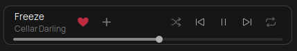

# another-spotibar

A tiny always-on-top mini player bar for the **Spotify desktop app on Linux**.
Title, artist, progress bar, prev / play-pause / next, shuffle, repeat, like (♥) and *add to playlist* (+) — in a small draggable, resizable strip.

*(Türkçe açıklama aşağıda / Turkish description below.)*

> Unofficial project. Not affiliated with or endorsed by Spotify.



## Features
- Always on top, draggable, width-resizable; remembers position and size
- Playback control over MPRIS (D-Bus), so it works with the regular Spotify desktop client
- Like / unlike the current track, add it to one of your playlists (searchable, recent first)
- Skins (dark, light, amoled, nord, sunset) + your own: colors, font sizes, corner radius, bar thickness — with live preview
- English and Türkçe interface

## Requirements
- Linux with a desktop session (X11 or XWayland), the Spotify desktop app
- Python 3.8+ and GTK3 bindings:
  - Debian / Ubuntu / Mint: `sudo apt install python3-gi gir1.2-gtk-3.0`
  - Fedora: `sudo dnf install python3-gobject gtk3`
  - Arch: `sudo pacman -S python-gobject gtk3`

## Install
```bash
git clone https://github.com/versuchers/another-spotibar.git
cd another-spotibar
./install.sh              # or ./install.sh --autostart to start on login
another-spotibar
```
Uninstall with `./uninstall.sh`. (`pip install --user .` also works if PyGObject is installed system-wide.)

## First run: Spotify login
Like and playlist features use the Spotify Web API, so you need your own (free) client ID:
1. Open <https://developer.spotify.com/dashboard> and create an app.
2. Add the redirect URI shown in the setup window (`http://127.0.0.1:8888/callback`).
3. Paste the app's **Client ID** into the setup window and log in via the browser.

Your token and settings are stored in `~/.config/another-spotibar/` (token file is `chmod 600`). Nothing is sent anywhere except to Spotify.

## Usage
- Drag the bar to move it; drag its left/right edge to resize.
- Right-click → **Settings** for skins, colors, sizes, language. *Save as skin* stores a custom skin in `~/.config/another-spotibar/skins/<name>.json`.
- The bar hides itself when Spotify isn't playing.

## Contributing
Forks and pull requests are welcome. Please keep the license notice.

## License
MIT — see [LICENSE](LICENSE). Copyright (c) 2026 Semih.

---

# Türkçe

**another-spotibar**, Linux'taki **Spotify masaüstü uygulaması** için küçük, her zaman üstte duran bir mini oynatıcı çubuğudur: şarkı adı, sanatçı, ilerleme çubuğu, önceki / oynat-duraklat / sonraki, karıştır, tekrar, beğen (♥) ve çalma listesine ekle (+).

> Resmi olmayan bir projedir; Spotify ile bağlantısı yoktur.

## Kurulum
```bash
sudo apt install python3-gi gir1.2-gtk-3.0   # Debian/Ubuntu/Mint
git clone https://github.com/versuchers/another-spotibar.git
cd another-spotibar
./install.sh              # açılışta başlasın istersen: ./install.sh --autostart
another-spotibar
```
Kaldırmak için `./uninstall.sh`.

## İlk çalıştırma
Beğen ve listeye ekle özellikleri Spotify Web API kullanır; bu yüzden kendi (ücretsiz) Client ID'ne ihtiyacın var. Kurulum penceresi adımları gösterir: dashboard'da uygulama oluştur → yönlendirme adresini ekle → Client ID'yi yapıştır → tarayıcıda giriş yap.

## Kullanım
Çubuğu sürükleyerek taşı, sol/sağ kenarından çekerek genişlet. Sağ tık → **Ayarlar**: skin, renkler, boyutlar, dil. Kendi skinlerin `~/.config/another-spotibar/skins/` altında saklanır.

## Lisans
MIT — bkz. [LICENSE](LICENSE). Telif: Semih, 2026. Fork'lamak ve değiştirmek serbest; lisans notu korunmalı.
